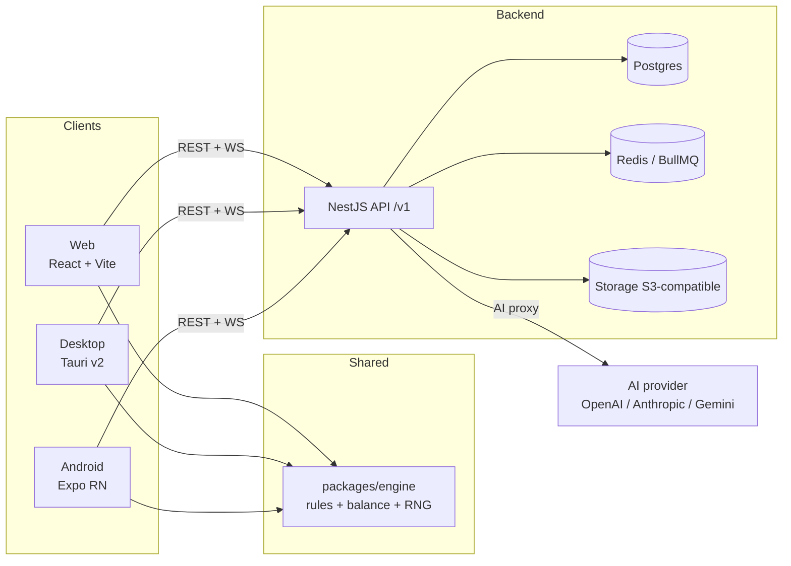

# LifeSpire — ARCHITECTURE

> **Version:** 1.0 (frozen for M0, 2026-10-18)
> **Date:** 2026-10-18
> **Scope:** technical specification. Game design lives in [`GDD.md`](./GDD.md). This document is the *hub*: deep details live in [`docs/`](./docs/README.md) and each individual decision in [`docs/adr/`](./docs/adr/README.md).
> **Language:** documents, code, entities and endpoints in English.

---

## Table of contents

1. [Overview and technical principles](#1-overview-and-technical-principles)
2. [General overview](#2-general-overview)
3. [Monorepo and packages](#3-monorepo-and-packages)
4. [The shared engine (`packages/engine`)](#4-the-shared-engine-packagesengine)
5. [Applications](#5-applications)
6. [Backend (NestJS)](#6-backend-nestjs)
7. [Sync and offline](#7-sync-and-offline)
8. [Authentication and security](#8-authentication-and-security)
9. [Evidence and storage](#9-evidence-and-storage)
10. [AI](#10-ai)
11. [Notifications](#11-notifications)
12. [Data model](#12-data-model)
13. [Testing and quality](#13-testing-and-quality)
14. [CI/CD, environments and infrastructure](#14-cicd-environments-and-infrastructure)
15. [Observability and operation](#15-observability-and-operation)
16. [Non-functional requirements](#16-non-functional-requirements)
17. [Decision log (ADRs)](#17-decision-log-adrs)
18. [Repository structure](#18-repository-structure)

---

## 1. Overview and technical principles

LifeSpire is a **TypeScript monorepo** with a **shared, deterministic game engine**, a **NestJS backend with authority over the economy** (event ledger), and **offline-first** clients for web, desktop and Android.

Principles that guide all technical decisions:

1. **A single source of truth for game rules.** Map, balance and validations live in `packages/engine` (pure TS, no platform dependencies) and run the same on web, mobile and server.
2. **Determinism by daily seed.** A day's map is reproducible bit for bit on any device, even offline.
3. **The economy is server-authoritative.** Gold, HP, XP and items are granted by applying **idempotent events** on the server (ledger). The client does optimistic UI and syncs.
4. **Truly offline-first.** The daily run can be played in full without a connection (including evidence, which is uploaded on reconnect).
5. **No secrets in the client.** No API key (AI, storage) ever touches the clients; everything goes through the backend.
6. **Technically multi-user from day 1.** All resources are scoped by `userId`, even though the current scope is personal.

---

## 2. General overview



- **Clients:** the UI is platform-specific (React DOM / React Native), but they share the engine, types and design tokens.
- **Backend:** REST `/v1` + change-notification WebSocket; Postgres for state, Redis for queues (AI and jobs), S3-compatible storage for evidence.
- **AI:** always via the backend proxy (provider configurable per environment).

---

## 3. Monorepo and packages

Management: **pnpm workspaces + Turborepo**. Strict TypeScript across the whole repo.

| Package | Type | Contents |
|---|---|---|
| `packages/engine` | Pure TS (no DOM, no Node APIs) | Deterministic RNG, map generation, balance in JSON, rules (damage, gold, XP, drops), validators, map layout for render |
| `packages/shared-types` | Pure TS | Zod schemas for DTOs and sync payloads; derived types; state enums |
| `packages/design-tokens` | TS/CSS | Colors, typography, spacing (roguelike dark theme) reused by web and (partially) mobile |
| `packages/config` | Dev config | Base tsconfig, ESLint, Prettier, base Vitest |

Dependency rules: `apps/*` → `packages/*`; `engine` depends on nothing in the repo; `shared-types` does not depend on `engine`; the backend also imports `engine` (to validate and pay out rewards).

---

## 4. The shared engine (`packages/engine`)

It is the technical heart: **every game rule lives here, only once**.

### 4.1 Public surface (engine API)

```ts
// Seed, day key and RNG
deriveDailySeed(userSeedSalt: string, dayKey: string, engineVersion: string): string
dayKey(timestampMs: number, tzOffsetMinutes: number, closeHour: number): string // pure, no Intl (ADR-017)
createRng(seed: string): Rng                                  // deterministic xoshiro128**

// Generation and validation
generateMap(seed: string, input: MapGenInput): MapData         // MapGenInput carries the rule profile (ADR-016)
validateMap(map: MapData, input: MapGenInput): ValidationResult // connectivity, guarantees (§5 GDD)
layoutMap(map: MapData): MapLayout                              // normalized positions for SVG

// Game rules (pure functions)
computeDamage(node: NodeType, difficulty: number, stats: StatSnapshot): number
computeRewards(node: NodeType, difficulty: number, streakDays: number): Rewards
computeDeathPenalty(gold: number, stats: StatSnapshot): DeathPenalty
xpToNext(level: number): number
difficultyBudget(playerLevel: number, successRate7d: number): number

// Balance (data, not code)
balance: BalanceTables   // loaded from balance/*.json
ENGINE_VERSION: string   // bump on every change that alters generation or rules
```

### 4.2 Determinism

- **Daily seed:** `dailySeed = HKDF(userSeedSalt, dayKey + engineVersion)`.
  - `userSeedSalt`: per-user secret (32 bytes, hex) that enables **offline generation** of the map. While there is no backend (M0) the client generates it at first launch; from M2 on it is the account's salt and the migration **adopts** the client's one (idempotent `PUT /users/me/seed-salt`, see §6.1 and [`docs/sync-offline.md`](./docs/sync-offline.md) §3). It is **never rotated** (ADR-015).
  - `dayKey`: the user's local date in their close hour (default 04:00), format `YYYY-MM-DD`. It is computed by the pure engine function `dayKey(timestampMs, tzOffsetMinutes, closeHour)` (arithmetic only, no `Intl`); the client refreshes `tzOffsetMinutes` with `Intl` when the app opens (ADR-017).
  - `engineVersion`: generator version frozen per run; updating the engine does not change maps already created.
- **Golden tests:** each `engineVersion` keeps map snapshots for test seeds; a generation change requires a version bump and new snapshots.
- **Server validation:** the server re-generates the run's map (same seed, same version) and validates its structure before accepting any event on it.

### 4.3 Data-driven balance

`packages/engine/balance/*.json` is the **canonical source** of the numbers in the [GDD Appendix A](./GDD.md#19-appendix-a--initial-balance): damage, gold, XP, drops, prices, map distribution, curves. Balancing = editing JSON + bumping `ENGINE_VERSION` if generation changes.

The same files declare the **rule profiles** that parameterize generation (`nodeTypeSet` + `guarantees`), so later content is enabled by editing data instead of rewriting the generator. M0 ships the reduced profile: `enemy` and `elite` only, no Rest/Shop guarantees and no Boss (ADR-016).

---

## 5. Applications

> M0 ships `apps/web` plus the `packages/*`; `apps/desktop`, `apps/mobile` and `apps/api` land in M4, M5 and M2 respectively. The rest of this section is the full target contract.

### 5.1 `apps/web` — React + Vite (main platform, M0)

| Aspect | Choice |
|---|---|
| Framework | React 19 + TypeScript + Vite |
| Routing | TanStack Router |
| Server state | TanStack Query (cache + retry + offline mutations) |
| Local/UI state | Zustand (run session, outbox driver, UI) |
| Styling | Tailwind CSS + shadcn/ui fed by `design-tokens` (single source of the visual tokens, ADR-011) |
| Map | SVG generated by `engine.layoutMap()` + animations with Framer Motion |
| Local persistence | IndexedDB (Dexie): outbox, run cache, evidence blobs, `meta` (cursor, `userSeedSalt`, `engineVersion`) |
| i18n | i18next + react-i18next: keys in English, source locale `es`, `Intl` for dates and numbers; no hardcoded text (ADR-012) |
| PWA | Installable and playable offline after the first load (`vite-plugin-pwa`) |
| Tests | Vitest (units) + Playwright (critical flows) |

### 5.2 `apps/desktop` — Tauri v2 (M4)

- Wraps the web build (same UI). Minimal size and RAM; signed binaries.
- `tauri-plugin-sql` (SQLite) for robust local storage; same outbox logic as web.
- **Native notifications** (timer end, reminders) + system tray.
- Auto-updater (artifact signing) and deep links.

### 5.3 `apps/mobile` — Expo React Native (M5)

- Its own UI oriented to the **daily loop** (simplified map, task, timer, camera for evidence, day close). UI is not shared with web (only logic and tokens).
- `expo-sqlite` for persistence, `expo-notifications` (FCM/APNs) for push, `expo-camera`/`expo-image-picker` + compression before uploading evidence.
- Fully offline: same outbox/sync protocol as web.

### 5.4 `apps/api` — NestJS (M2)

See §6.

---

## 6. Backend (NestJS)

**Stack:** NestJS + TypeScript · Postgres 16 + Prisma · Redis (BullMQ) · S3-compatible storage · WebSocket (socket.io) · REST `/v1`.

### 6.1 Modules

| Module | Responsibility |
|---|---|
| `auth` | Registration/login (Argon2id), JWT + rotating refresh, devices, revocation, optional OAuth |
| `users` | Profile, settings (close hour, TZ, vacation), `seedSalt` adoption during migration, data export/deletion |
| `goals` | Goals and milestones (CRUD, states, progress) |
| `runs` | Run of the day: seed, map, nodes, tasks (instances, routines and pool drafts), day close and death |
| `economy` | **Event ledger** append-only; derived balances (gold, run HP, XP); death penalties; streak multipliers |
| `inventory` | Items per user (consumables, vouchers); use and consumption; revocation on death |
| `shop` | Offers per visit + personal voucher catalog; transactional purchases |
| `quests` | Daily quests: assignment, automatic progress from the ledger |
| `events` | Personal decks, cards, draws, resolution (accept/decline/reroll) |
| `evidence` | Signed uploads, confirmation, read URLs, retention and deletion |
| `ai` | AI proxy: flows, JSON contracts, cache, budgets, queues, auditing (see [`docs/ai.md`](./docs/ai.md)) |
| `sync` | Offline push/pull, idempotency, change WebSocket (see [`docs/sync-offline.md`](./docs/sync-offline.md)) |
| `notifications` | Push tokens per device, preferences, dispatch (timer end, recaps) |

### 6.2 The economy is server-authoritative (ledger)

The server **never** trusts balances sent by the client; only **events**:

1. The client proposes an operation (`clientOpId` UUIDv7 + payload) from the optimistic UI.
2. The server processes it in a transaction: validates state + engine rules, inserts the ledger entry (`ON CONFLICT (clientOpId) DO NOTHING`) and updates materialized balances.
3. A retry of the same `clientOpId` returns the **original result** (idempotent replay), never duplicating gold/XP.
4. Invalid operation (e.g. insufficient gold) → rejected, the client reverts the UI and explains.

Ledger entry types: `gold_gain`, `gold_spend`, `hp_loss`, `hp_heal`, `xp_gain`, `item_grant`, `item_consume`, `death_penalty`, `quest_reward`, `streak_bonus`. The ledger is append-only, auditable and exportable (transparency for the user).

---

## 7. Sync and offline

Summary (full protocol in [`docs/sync-offline.md`](./docs/sync-offline.md)):

- **Operation outbox** on the client (IndexedDB/SQLite): every game action queued with `clientOpId`, applied optimistically in the UI.
- **Push** (`POST /v1/sync/push`): batch of operations → the server responds applied / duplicated / rejected per op.
- **Pull** (`GET /v1/sync/pull?cursor=`): server changes since the last cursor; merge by per-entity rules (mostly LWW; task terminal states win; evidence is append-only).
- **WebSocket** (`/v1/sync/stream`): it only signals "there are changes" → the client pulls. It never carries critical state.
- **Full offline:** map generated locally with the cached `userSeedSalt`; tasks, timers and evidence work without network; on reconnecting the outbox is drained (blobs included).

---

## 8. Authentication and security

- **Auth:** email + password (Argon2id) with **JWT access (15 min)** + **rotating refresh (30 days, hashed in DB)**; device list with remote revocation. Optional Google OAuth (M2 phase).
- **Multi-user isolation:** all resources scoped by `userId`; authorization at the service layer (guards + policies), not only in queries.
- **Minimal surface:** input validation with zod (pipes), Helmet, CORS allowlist, per-user rate limiting, size limits on uploads.
- **Secrets:** server-side only (deployment env). Clients never receive AI, storage or DB keys.
- **Evidence photos:** private bucket, short-lived signed URLs (5 min read), provider-side encryption at rest.
- **Data privacy:** full JSON export and account deletion with purge (DB + storage). Details in §16.
- **Light anti-abuse:** trust is on an honor basis (GDD pillar), but ledger idempotency prevents accidental or malicious duplication across devices.

---

## 9. Evidence and storage

- **Upload flow:** `POST /v1/evidence/uploads` (metadata) → signed PUT URL → direct client upload → `POST /v1/evidence/:id/confirm` (checksum) → evidence associated with the task.
- **Format:** JPEG/PNG/WebP; client-side compression to ~1600 px (WebP q0.8 recommended); max 10 MB; daily limit per user (configurable, default 50 files); SHA-256 checksum. Photo, note or link only (no video). Full policy in ADR-014.
- **Offline:** pending evidence lives in local storage (blob) and is uploaded on reconnect; the task can be completed before the upload finishes (confirmation syncs afterwards). In M0 (no backend) evidence never leaves the device. The web client calls `navigator.storage.persist()` on first use and warns when local usage crosses 80 % of the estimated quota.
- **Retention:** per-user setting (keep forever / purge photos older than N months); account deletion removes the whole bucket.
- **Storage:** S3-compatible — dev: MinIO (docker-compose); prod: Cloudflare R2 or S3.

---

## 10. AI

Always through the **backend proxy** (no keys in clients). Summary; details in [`docs/ai.md`](./docs/ai.md):

- **Provider adapter** configurable per environment (`AI_PROVIDER`, `AI_MODEL_FAST`, `AI_MODEL_SMART`): OpenAI, Anthropic or Gemini.
- **Validated JSON contracts** (zod) for each flow (`plan_goal`, `generate_tasks`, `suggest_decks`, `shop_offers`, `setup_stats_skills`, `weekly_recap`): invalid output → repair retry → if it fails, fallback to curated pools.
- **Cached** by `(flow, hash(input))` so the same generation is never paid for twice.
- **Budget and limits:** monthly token quota per user, rate limit per endpoint, BullMQ queue for long flows (plan/recap) with `202 + jobId` status.
- **No-AI fallback:** every flow has a pool of curated templates; the game is 100% playable without AI or a connection.
- **Privacy:** only text is sent (never photo evidence); context is minimized; usage auditing (`AiUsage`) for costs and control.
- **Guardrails:** the AI proposes; nothing is applied to the real world without user approval (a game rule, also enforced in the backend).

---

## 11. Notifications

| Channel | Use |
|---|---|
| Mobile push (Expo → FCM/APNs) | Timer end, day reminder (optional), weekly recap |
| Tauri native notifications | Same on desktop (includes timer persistence) |
| Web Push (VAPID) | Optional; web also uses local notifications if the tab is open |
| Internal WebSocket | Not a user notification, but it tells other devices about changes (see §7) |

Rules: every notification is configurable and friendly in tone (anti-guilt pillar); never more than 1 day reminder is sent unless explicitly configured. Timer end uses scheduled **local** notifications (they work offline); the rest are dispatched from `notifications` with per-device tokens.

---

## 12. Data model

Entities, fields and ER diagram: [`docs/data-model.md`](./docs/data-model.md). Key rule: **catalogs (items, template cards, balance) live in versioned `packages/engine`; the database stores per-user instances** (owned items, approved cards, shop offers, etc.).

Entity groups:

- **Identity:** `User`, `UserSettings`, `Device`, `Session`
- **Goals:** `Goal`, `Milestone`
- **Run:** `Run`, `MapNode`, `TaskInstance`, `TimerSession`, `Evidence`
- **Planned content:** `Routine`, `TaskDraft`
- **Economy:** `LedgerEntry`, `InventoryItem`
- **Personal content:** `EventCard`, `RewardDef`, `ShopOffer`, `DailyQuest`, `StatDef`, `Skill`
- **Progress:** `StreakState`, `WeeklyReview`
- **AI:** `AiJob`, `AiUsage`

---

## 13. Testing and quality

| Layer | Tools | What it covers |
|---|---|---|
| `engine` | Vitest + fast-check | Determinism (golden snapshots per version), map invariants per rule profile —connectivity, guarantees, budgets— (ADR-016), formula properties (never negative damage, death ≤ 100%…) |
| Balance simulator | CLI in `engine` (`pnpm sim:balance`) | Monte Carlo: simulated player profiles → death rates, gold/day, progression; validates the GDD Appendix A targets |
| `api` | Jest + Supertest + Testcontainers | Module E2E against a real Postgres; ledger idempotency; permissions |
| `web` | Vitest + Playwright | Critical flows: onboarding → full day → death → sync; basic visual regression of the map |
| `desktop` / `mobile` | Smoke tests (each app's phase) | Startup, offline, notifications |

**Quality gates:** lint + typecheck + unit on every PR; e2e on merge to `main`; the balance simulator runs weekly and reports deviations from the targets.

---

## 14. CI/CD, environments and infrastructure

- **Toolchain:** Node 24 LTS + pnpm 11 (`packageManager` + corepack), strict TypeScript, ESLint 9 (flat config) + Prettier 3, package scope `@lifespire/*`, Conventional Commits, trunk-based with protected `main` and PRs for large changes, MIT license (ADR-013).
- **CI (GitHub Actions):** lint → typecheck → unit → build → e2e. pnpm/Turborepo caching.
- **Local dev:** `docker/compose.dev.yml` with Postgres 16, Redis 7, MinIO and Mailpit (auth emails). `pnpm dev` brings everything up with Turborepo.
- **Environments:** `dev` (local), `staging` (test data, same infra as prod), `prod`.
- **Proposed deployment (personal-first):**
  - API: Fly.io (minimum 2 machines) or VPS (Hetzner) with Docker Compose + Caddy.
  - Web: Cloudflare Pages (static assets).
  - Postgres: managed Neon or Supabase (or self-hosted Postgres with backups).
  - Redis: Upstash (queues).
  - Evidence storage: Cloudflare R2.
- **Backups:** daily `pg_dump` + WAL archiving to R2; documented monthly restore test.
- **Migrations:** Prisma Migrate in CI with mandatory review; never destructive without a plan.
- **Client versioning:** web/desktop always compatible with `/v1`; per-run `engineVersion` guarantees stable maps during updates.

---

## 15. Observability and operation

- **Errors:** Sentry in API, web, desktop and mobile.
- **Logs:** structured pino (JSON) with `requestId` and `userId` (no plaintext PII); 30-day retention.
- **Health:** `GET /health` (liveness) + `GET /health/ready` (DB, Redis, storage).
- **Minimal product metrics:** runs started/closed, death rate, AI usage per flow and cost, outbox size (sync health).
- **Alerts:** sync failures > X%, 5xx errors > Y/min, global AI budget at 80%.
- **AI operation:** per-provider kill switch (env var) to cut spending; the game keeps working via fallback.

---

## 16. Non-functional requirements

| Area | Requirement |
|---|---|
| Performance | Interactive map < 1 s from load; 60 fps in animations; web first paint < 2 s on 4G; mobile startup < 3 s |
| Offline | Daily run 100% playable without a connection on all 3 platforms; automatic sync on reconnect |
| i18n | Spanish (source locale) since M0 → English added in M6. i18next with keys in English; texts externalized from day 1 (ADR-012) |
| Accessibility | AA contrast, visible focus, keyboard navigation on web/desktop, `prefers-reduced-motion` respected |
| Privacy | Minimal data; private evidence with signed URL; full JSON export; account deletion with purge; no third-party trackers |
| Security | OWASP Top 10 as reference checklist; no secrets in client; rate limiting; input validation |
| Costs | Monthly AI budget per user + global; aggressive cache; cheap single-region infra while it stays personal |
| Maintainability | A single rules engine; shared zod contracts; ADRs for every structural decision |

---

## 17. Decision log (ADRs)

| ID | Decision | Status |
|---|---|---|
| ADR-001 | pnpm + Turborepo monorepo with apps/packages | Accepted |
| ADR-002 | Shared game engine in pure TS (`packages/engine`) with deterministic RNG | Accepted |
| ADR-003 | Server-authoritative economy via idempotent event ledger | Accepted |
| ADR-004 | AI exclusively through the backend proxy, configurable provider | Accepted |
| ADR-005 | Postgres + Prisma as the database | Accepted |
| ADR-006 | Offline-first with outbox + incremental pull (no CRDT) | Accepted |
| ADR-007 | Tauri v2 for desktop (reuses the web build) | Accepted |
| ADR-008 | React Native + Expo for Android, own UI (no react-native-web) | Accepted |
| ADR-009 | Evidence in S3-compatible storage with signed URLs | Accepted |
| ADR-010 | REST API `/v1` + WebSocket (no GraphQL) | Accepted |
| ADR-011 | React 19 + Vite web stack on TanStack, Zustand and Tailwind | Accepted |
| ADR-012 | i18next + react-i18next internationalization, no hardcoded text | Accepted |
| ADR-013 | Node 24 + pnpm 11 toolchain, `@lifespire/*` scope, MIT, conventional commits | Accepted |
| ADR-014 | Client-side evidence policy: compression, quotas, local blob queue | Accepted |
| ADR-015 | Local-first `userSeedSalt` generated in the client and adopted by the server | Accepted |
| ADR-016 | Map generation parameterized by rule profiles in balance JSON | Accepted |
| ADR-017 | `dayKey` as a pure engine function, no `Intl` dependency | Accepted |

Detailed records live in [`docs/adr/`](./docs/adr/README.md) (one file per decision, with context, decision and consequences). New decisions are documented as individual ADRs there and summarized here in the same change.

---

## 18. Repository structure

```
lifespire/
├── apps/
│   ├── api/                 # NestJS (M2)
│   ├── web/                 # React + Vite (M0)
│   ├── desktop/             # Tauri v2 (M4)
│   └── mobile/              # Expo React Native (M5)
├── packages/
│   ├── engine/              # Rules, RNG, balance JSON, map generation
│   ├── shared-types/        # Zod schemas + API and sync DTOs
│   ├── design-tokens/       # Colors, typography, spacing
│   └── config/              # base tsconfig/eslint/prettier/vitest
├── docs/                    # Documentation (this hub points here)
│   ├── README.md
│   ├── api/README.md
│   ├── data-model.md
│   ├── sync-offline.md
│   ├── ai.md
│   ├── roadmap.md
│   ├── open-questions.md
│   └── adr/                 # Individual ADRs (ADR-001…ADR-017)
├── docker/                  # dev compose (Postgres, Redis, MinIO, Mailpit)
├── .github/workflows/       # CI (lint, typecheck, test, build, e2e)
├── GDD.md
├── ARCHITECTURE.md
├── AGENTS.md                # Guide for AI agents (where each thing goes and repo rules)
├── LICENSE                  # MIT
├── package.json
├── pnpm-workspace.yaml
└── turbo.json
```

---

*This document is kept in sync with [`GDD.md`](./GDD.md) and [`docs/`](./docs/README.md). Any structural change requires an ADR (see §17).*
