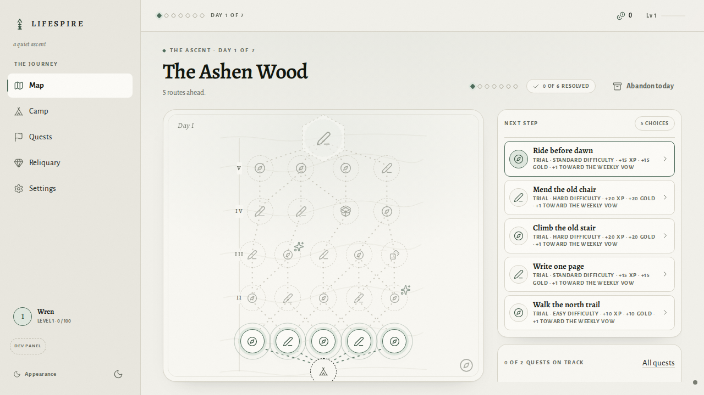
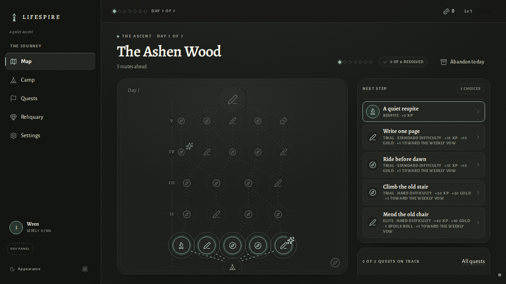
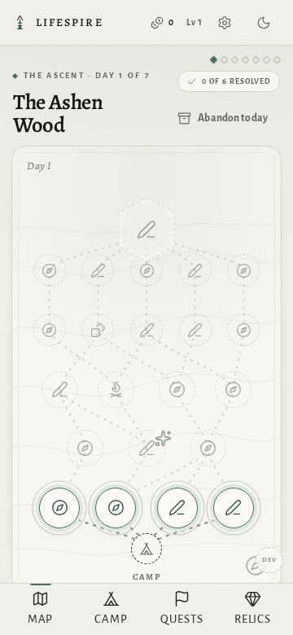
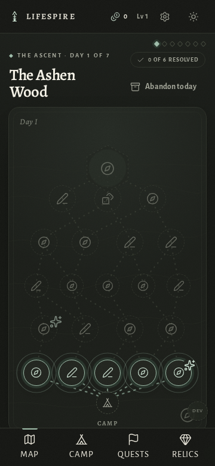

# LifeSpire

**Turn your quests and trials into a daily encounter map.**

LifeSpire turns a person's quests and trials into a daily encounter map inspired
by *Slay the Spire*. Each day you choose a route; each encounter is a real-world
action (a trial, a respite, a hoard, a wheel of fortune, or the daily warden).
A **journey** lasts 7 days with weekly vows — the more you claim, the more gold,
XP, and spoils you earn.

It's local-first on **web, Android and desktop**: one profile, playable with no
account or server. The web app is installable as a PWA and fully usable offline
after the first load. The Android app (Expo/React Native) shares the same
domain and save format, adds device-local reminders for the daily map, an
unresolved evening and the end of the journey, and pairs with the desktop app over
the local network. Nearby sync is **serverless**: devices discover each other
over UDP, pair with a QR or an 8-character code, and exchange saves over HTTPS
with per-device self-signed certificates and certificate pinning. There is no
cloud copy. The Electron shell runs the same web build and hosts the desktop
LAN node. See `docs/adr/0007-local-lan-sync.md`, `docs/MOBILE.md` and
`docs/DESKTOP.md`.

The encounter map is the heart of the app: each day you pick a route through
3–15 layers plus a warden, with visible trade-offs between progress, difficulty,
and reward. The depth follows the quests that have active trials and their
weekly vows, while the width follows your trials.

---

## Screenshots

| Light theme | Dark theme |
|---|---|
|  |  |

Mobile layouts are fully supported:

| Mobile (light) | Mobile (dark) |
|---|---|
|  |  |

---

## Quick start

```bash
pnpm install --frozen-lockfile
pnpm dev        # web dev server
pnpm dev:mobile # Android app (Expo)
pnpm dev:desktop # Electron shell (run `pnpm dev` in another terminal)
```

Open the printed web URL. For Android, open the project in Expo Go for UI work,
but use a development build (`pnpm --filter @lifespire/mobile android:native`) or
an EAS build for Nearby devices: Expo Go does not include the LAN Kotlin
module. `docs/MOBILE.md` covers the SDK, local notifications and the release
checklist. For desktop, `docs/DESKTOP.md` covers the packaged builds, the
`electron-updater` channel and the tag-driven release workflow. On first launch
you can load **demo data** and start a journey in one click, or create your own
quests and trials.

Android updates ship through the self-hosted F-Droid repository at
`https://togudv.github.io/lifespire/fdroid/repo/`; desktop builds update from
GitHub Releases. The app checks for updates in the background and in
Settings → About, but never downloads or installs an APK itself. See
[`docs/FDROID.md`](./docs/FDROID.md) for the repository, signing keys and repair
workflow. LifeSpire is MIT licensed.

Nearby sync needs both apps open on the same Wi-Fi. On the desktop, Settings →
Nearby devices → **Show my code**; on Android, scan the QR or enter the code.
The browser is local-only by design: it cannot open sockets or trust a pinned
self-signed certificate. Use export/import to move a browser save.

### Requirements

- Node 24 (see `.nvmrc`)
- pnpm 11 (see `packageManager` in `package.json`)

### Scripts

```bash
pnpm lint       # oxlint
pnpm typecheck  # TypeScript (tsc -b)
pnpm typecheck:e2e  # E2E TypeScript (tsc -p tsconfig.e2e.json)
pnpm test       # Vitest (web/core/app-core/desktop) + Jest (Android planner)
pnpm build      # typecheck + production build + Android JS bundle
pnpm preview    # serve the build (test PWA / offline)
```

---

## How it works

1. **Onboarding** — pick demo data or create 1–10 quests with their trials.
2. **Each day** — open the day's map (3–15 decision layers + a warden, 3–5
   encounters per layer; depth follows the quests with active trials and their
   weekly vows), pick an encounter, do the real-world action, mark it claimed.
3. **Rewards** — XP, gold, and spoils are granted instantly. Trials also add
   progress to their quest's weekly vow.
4. **Close the day** — claiming the warden ends the day with a bonus.
5. **Close the journey** — after 7 days you get a weekly summary with bonuses
   and spoils. Start a new journey keeping your profile, gold, XP, and
   collection.

Route choice has visible trade-offs: trials advance the week, hoards pay
immediately but give no progress, elites pay double in exchange for more
difficulty.

---

## Scope

**In scope**

- Onboarding with demo or custom data; 1–10 quests with trials
- 7-day journeys with deterministic maps (3–15 layers + warden, driven by the quests with active trials)
- Encounter types: trial, elite, respite, hoard, wheel of fortune, warden
- Instant rewards (XP, gold, spoils), weekly progress, day & journey summaries
- New journey keeping profile, gold, XP, and collection
- Local persistence with JSON export/import and reset
- Dev panel to advance days and simulate a week
- PWA, offline after first load, responsive (360px → desktop)

**Out of scope**

Public accounts, email/password login, a cloud copy, remote push, combat,
cards, deckbuilding, shop, relics with gameplay effects, calendar/health
integrations, automatic task verification and social features.

> Relics are a **collection** in the current scope (12 items, rarities, duplicates
> convert to gold). Gameplay-effect relics are deliberately deferred — see
> [`docs/ARCHITECTURE.md`](./docs/ARCHITECTURE.md) §8.

---

## Project layout

```
apps/web/src/
  domain/      pure, testable logic (map, rewards, lifecycle, run close, schema)
  content/     loot catalog + demo factory
  state/       Zustand store + persist + injectable clock
  ui/          components & screens (no router — view state)
  styles/      tokens + app styles
apps/desktop/ local LAN node (Electron main) + shell
apps/mobile/  Expo Android app + modules/lifespire-lan (Kotlin)
packages/core/ pure domain shared by every client
packages/app-core/ store, persistence and the local sync engine
```

Maps are rendered with custom SVG. No graph library, no UI kit.

---

## Documentation

- Spec & rules: [`SPEC.md`](./SPEC.md)
- Architecture & contracts: [`docs/ARCHITECTURE.md`](./docs/ARCHITECTURE.md)
- Local sync: [`docs/adr/0007-local-lan-sync.md`](./docs/adr/0007-local-lan-sync.md) + [`docs/adr/`](./docs/adr/)
- Design system: [`design/DESIGN.md`](./design/DESIGN.md) — the spec the app implements
- UI notes: [`docs/UI.md`](./docs/UI.md)
- PWA / offline: [`docs/PWA.md`](./docs/PWA.md)
- Playtest protocol: [`docs/playtest-plan.md`](./docs/playtest-plan.md)
- Agent guide: [`AGENTS.md`](./AGENTS.md)

---

## Persistence

The versioned game document lives in `lifespire:mvp0` (compact JSON in storage,
readable two-space JSON on export). A best-effort previous copy is kept under
`lifespire:mvp0:backup` before a destructive import or reset, per-peer merge
bases live under `lifespire:peer:<id>:base|meta`, and sound/haptics
preferences live separately under `lifespire:feedback-prefs`. Pairing tokens
and the device certificate stay in the native vault (Electron `safeStorage`,
Android Keystore), never in `localStorage` or the save. There is no cloud copy;
export is the off-device backup. Settings →
export/import produces a readable JSON backup or restores one. The dev panel
only exists in `pnpm dev`.

---

## Branch

Everything lives on `main`, the development and release line. Use short-lived
branches (`feat/...`, `fix/...`) for larger changes and merge back.

```bash
git checkout main
```