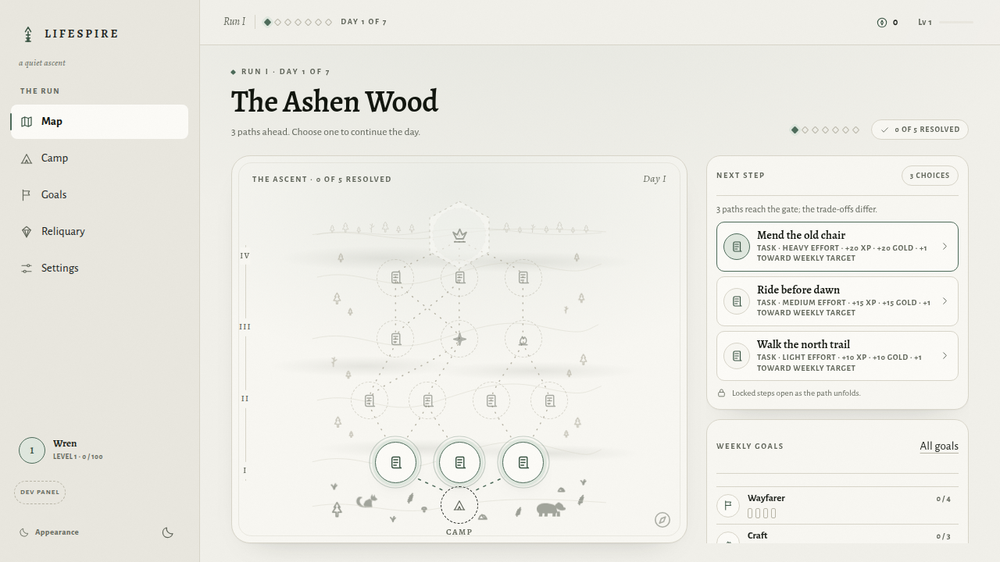
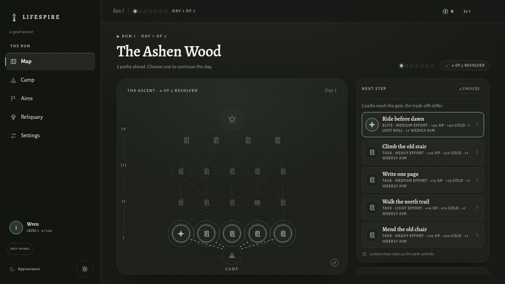
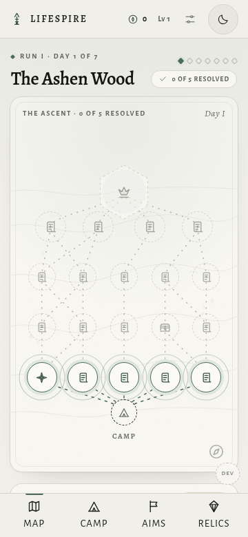
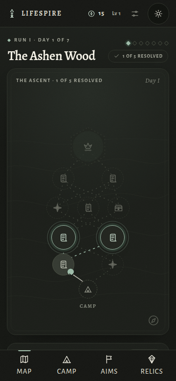

# LifeSpire

**Turn your goals and routines into a daily node map.**

LifeSpire turns a person's goals and routines into a daily node map inspired by
*Slay the Spire*. Each day you choose a path; each node is a real-world action
(a task, a rest, a treasure, a wheel, or the daily boss). A **run** lasts 7 days
with weekly objectives — the more you complete, the more gold, XP, and loot you
earn.

It's local-first on **web, Android and desktop**: one profile, playable as a
guest with no server. The web app is installable as a PWA and fully usable
offline after the first load. The Android app (Expo/React Native) shares the
same domain, save format and optional sync, and adds device-local reminders for
the daily map, an unresolved evening and the end of the run. The desktop app is
an Electron shell around the same web build, shipped as a `.deb`/AppImage,
portable Linux build and a Windows installer; an optional closed-beta sync API
(NestJS + Postgres) links a user's devices. See `docs/BACKEND.md`,
`docs/RUNBOOK.md`, `docs/MOBILE.md` and `docs/DESKTOP.md`. Deploying the sync
stack? Jump to [Deploy (VPS)](#deploy-vps).

The node map is the heart of the app: each day you pick a path through 3–15 layers
plus a boss, with visible trade-offs between progress, effort, and reward. The
depth follows the goals that have active routines and their weekly targets,
while the width follows your routines.

---

## Screenshots

| Light theme | Dark theme |
|---|---|
|  |  |

Mobile layouts are fully supported:

| Mobile (light) | Mobile (dark) |
|---|---|
|  |  |

---

## Quick start

```bash
pnpm install --frozen-lockfile
pnpm dev        # web dev server
pnpm dev:mobile # Android app (Expo)
pnpm dev:desktop # Electron shell (run `pnpm dev` in another terminal)
```

Open the printed web URL. For Android, open the project in Expo Go or run a
development build with `pnpm --filter @lifespire/mobile android:native`.
`docs/MOBILE.md` covers the SDK, the server URL override, local notifications
and the release checklist. For desktop, `docs/DESKTOP.md` covers the packaged
builds and the tag-driven release workflow. On first launch you can load **demo
data** and start a run in one click, or create your own goals and routines.

### Full local stack (single command, hot reload)

```bash
docker compose -f infra/docker-compose.local.yml up --build
```

Web at http://localhost:5173, API at http://localhost:3000, Postgres at
`localhost:5433`. The repo is bind-mounted: Nest restarts on API changes and
Vite HMR applies web changes instantly. First boot runs `pnpm install`,
`prisma generate` and `migrate deploy` automatically; create the first admin
with `docker compose -f infra/docker-compose.local.yml exec -T api pnpm --filter @lifespire/api admin:create --email admin@example.com`.

### Requirements

- Node 24 (see `.nvmrc`)
- pnpm 11 (see `packageManager` in `package.json`)

### Scripts

```bash
pnpm lint       # oxlint
pnpm typecheck  # TypeScript (tsc -b)
pnpm typecheck:e2e  # E2E TypeScript (tsc -p tsconfig.e2e.json)
pnpm test       # Vitest (web/core/API) + Jest (Android planner)
pnpm build      # typecheck + production build + Android JS bundle
pnpm preview    # serve the build (test PWA / offline)
```

---

## Deploy (VPS)

You need Docker with Compose and a domain. Pick one HTTPS setup:

- **Mode A** — you already run a reverse proxy (Nginx Proxy Manager, nginx,
  Traefik…).
- **Mode B** — you don't; the bundled Caddy overlay handles the certificate.

### 1. Configure

```bash
git clone https://github.com/ToguDV/lifespire.git
cd lifespire
cp apps/api/.env.example .env
```

Edit `.env`:

- `POSTGRES_PASSWORD` — a strong password;
- `JWT_SECRET` — run `openssl rand -base64 48`;
- `TOTP_ENCRYPTION_KEY` — run `openssl rand -base64 32`;
- `PUBLIC_WEB_URL` and `CORS_ORIGINS` — `https://your.domain`.

For mode B also set `DOMAIN=your.domain` and `ACME_EMAIL=you@example.com`.

### 2. Start

Mode A:

```bash
docker compose --env-file .env -f infra/docker-compose.prod.yml up -d --build --remove-orphans
```

`--remove-orphans` stops an old Caddy container if you are migrating from that
setup. Point your proxy at the API and forward **everything**:

- `http://127.0.0.1:3000` if it runs on the host;
- `http://api:3000` if it shares the `lifespire_internal` network
  (`docker network connect lifespire_internal <proxy-container>`).

Mode B:

```bash
docker compose --env-file .env -f infra/docker-compose.prod.yml \
  -f infra/docker-compose.caddy.yml up -d --build
```

Caddy gets the certificate and forwards everything to the API. No path rules
are needed in either mode.

### 3. First admin

There is no default admin: create it on the server. Without a password the
account starts as `PENDING`, so then generate a one-time link to set one:

```bash
docker compose --env-file .env -f infra/docker-compose.prod.yml exec api \
  node dist/cli/admin-create.js --email you@example.com
docker compose --env-file .env -f infra/docker-compose.prod.yml exec api \
  node dist/cli/admin-reset-link.js --email you@example.com
```

Open the app, go to **Settings → Sync → “Forgot your password?”**, paste the
printed link, and choose a password (12+ characters). Then sign in and finish
TOTP setup. The link expires in 1 hour and is single-use. If the account
already exists, skip the first command.

Alternatively, set the password directly with
`admin-create.js --email you@example.com --password '…'` (12+ characters); it
will be left in your shell history.

### 4. Verify

```bash
curl https://your.domain/health/ready
# {"status":"ok","db":"up"}
```

### Updating

```bash
git pull
docker compose --env-file .env -f infra/docker-compose.prod.yml up -d --build
```

Migrations run automatically on start. Add `-f infra/docker-compose.caddy.yml`
if you use mode B. Backups, rollback, proxy timeouts and troubleshooting:
[`docs/RUNBOOK.md`](./docs/RUNBOOK.md).

---

## How it works

1. **Onboarding** — pick demo data or create 1–10 goals with their routines.
2. **Each day** — open the day's map (3–15 decision layers + a boss, 3–5 nodes
   per layer; depth follows the goals with active routines and their weekly
   targets), pick a node, complete the real-world action, mark it done.
3. **Rewards** — XP, gold, and loot are granted instantly. Tasks also add
   progress to their goal's weekly objective.
4. **Close the day** — resolving the boss ends the day with a bonus.
5. **Close the run** — after 7 days you get a weekly summary with bonuses and
   loot. Start a new run keeping your profile, gold, XP, and collection.

Path choice has visible trade-offs: tasks advance the week, treasures pay
immediately but give no progress, elites pay double in exchange for more effort.

---

## Scope

**In scope**

- Onboarding with demo or custom data; 1–10 goals with routines
- 7-day runs with deterministic maps (3–15 layers + boss, driven by the goals with active routines)
- Node types: task, elite, rest, treasure, wheel, boss
- Instant rewards (XP, gold, loot), weekly progress, day & run summaries
- New run keeping profile, gold, XP, and collection
- Local persistence with JSON export/import and reset
- Dev panel to advance days and simulate a week
- PWA, offline after first load, responsive (360px → desktop)

**Out of scope**

Public accounts, notifications, combat, cards, deckbuilding, shop,
relics with gameplay effects, calendar/health integrations, automatic task
verification, social features, native apps. (Sync exists as a closed-beta API
with admin invites — see `docs/BACKEND.md`.)

> Relics are a **collection** in the current scope (12 items, rarities, duplicates
> convert to gold). Gameplay-effect relics are deliberately deferred — see
> [`docs/ARCHITECTURE.md`](./docs/ARCHITECTURE.md) §8.

---

## Project layout

```
apps/web/src/
  domain/      pure, testable logic (map, rewards, lifecycle, run close, schema)
  content/     loot catalog + demo factory
  state/       Zustand store + persist + injectable clock
  ui/          components & screens (no router — view state)
  styles/      tokens + app styles
apps/api/      NestJS sync API (closed-beta; see docs/BACKEND.md)
packages/core/ pure domain shared with the API (extracting; see docs/adr/0003-monorepo.md)
packages/api-client/ typed fetch client for the sync API
infra/         prod compose (API + Postgres; opt-in Caddy overlay), backup script
```

Maps are rendered with custom SVG. No graph library, no UI kit.

---

## Documentation

- Spec & rules: [`SPEC.md`](./SPEC.md)
- Architecture & contracts: [`docs/ARCHITECTURE.md`](./docs/ARCHITECTURE.md)
- Sync backend: [`docs/BACKEND.md`](./docs/BACKEND.md) + [`docs/adr/`](./docs/adr/)
- VPS runbook: [`docs/RUNBOOK.md`](./docs/RUNBOOK.md)
- Design system: [`design/DESIGN.md`](./design/DESIGN.md) — the spec the app implements
- UI notes: [`docs/UI.md`](./docs/UI.md)
- PWA / offline: [`docs/PWA.md`](./docs/PWA.md)
- Playtest protocol: [`docs/playtest-plan.md`](./docs/playtest-plan.md)
- Agent guide: [`AGENTS.md`](./AGENTS.md)

---

## Persistence

The versioned game document lives in `lifespire:mvp0` (compact JSON in storage,
readable two-space JSON on export). A best-effort previous copy is kept under
`lifespire:mvp0:backup` before a destructive import or reset, and sound/haptics
preferences live separately under `lifespire:feedback-prefs`. Settings →
export/import produces a readable JSON backup or restores one. The dev panel
only exists in `pnpm dev`.

---

## Branch

Everything lives on `main`, the development and release line. Use short-lived
branches (`feat/...`, `fix/...`) for larger changes and merge back.

```bash
git checkout main
```