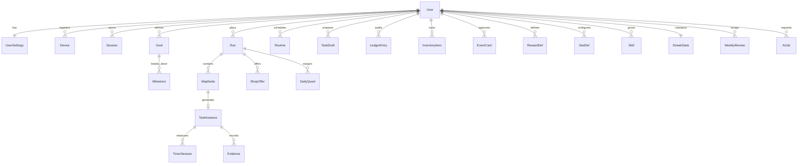

# Data model

> **Status:** specification (v1.0, frozen 2026-10-18). Source of truth for entities and relations.
> Engine: Postgres 16 + Prisma. The **static catalogs** (items, balance, quest templates) live in `packages/engine`; here only per-user data is persisted.

---

## 1. Conventions

- **IDs:** UUIDv7 (`text`), time-ordered, generated on the client for offline operations.
- **Timestamps:** `createdAt` / `updatedAt` in UTC with millisecond precision.
- **Soft state:** user content is archived (`archived`) before deleting; the ledger is **append-only and immutable**.
- **Materialized balances:** `User.gold`, `User.xp`, `User.level` and `Run.hp.current` are transactional caches of the ledger; always reconstructible (`SELECT` on the ledger). The source of truth is the ledger entries.
- **Ownership:** every row with user data carries `userId` (directly or via parent) for authorization and purge.

---

## 2. ER diagram (core)

---

## 3. Entities

### 3.1 Identity

#### `User`

| Field | Type | Notes |
|---|---|---|
| `id` | uuid PK | UUIDv7 |
| `email` | text unique | Login |
| `passwordHash` | text? | Argon2id; nullable if OAuth |
| `name` | text | Display name |
| `timezone` | text | IANA (`America/Bogota`) |
| `dayCloseHour` | int | 0–23, default `4` (local hour at which the day changes) |
| `vacationMode` | bool | Pauses runs and streak |
| `userSeedSalt` | text | 32-byte secret (hex) for the daily seed. Generated locally by the client while there is no backend (M0); adopted by the server on migration; never rotated (see `docs/adr/0015-local-first-seed-salt.md`). |
| `gold` | int | Materialized balance (≥ 0) |
| `xp` | int | XP accumulated in the current level |
| `level` | int | ≥ 1 |
| `createdAt` / `updatedAt` | timestamptz | |

#### `UserSettings` (1:1 with `User`)

`notifications` (jsonb: types and schedules), `evidenceRetentionDays` (int?, null = keep), `locale` (`es`), `theme`, `aiMonthlyTokenBudget` (int, nullable = global default).

#### `Device`

`id`, `userId`, `platform` (`web` | `desktop` | `android`), `pushToken?`, `lastSeenAt`, `createdAt`.

#### `Session` (refresh tokens)

`id`, `userId`, `deviceId?`, `refreshTokenHash`, `familyId`, `expiresAt`, `revokedAt?`, `createdAt`. Rotation: each refresh creates a new record and revokes the previous one; reuse → revoke the whole family.

---

### 3.2 Goals

#### `Goal`

| Field | Type | Notes |
|---|---|---|
| `id` | uuid PK | |
| `userId` | uuid FK | |
| `title` | text | |
| `description` | text? | |
| `horizonDate` | date? | Target date of the goal |
| `status` | enum | `active` · `paused` · `achieved` · `archived` |
| `skillIds` | uuid[] | Related domains |
| `createdAt` / `updatedAt` | timestamptz | |

#### `Milestone`

`id`, `goalId` FK, `title`, `description?`, `targetDate` (date), `status` (`pending` · `in_progress` · `achieved` · `reprogrammed`), `progressPercent` (int, derived from tasks), `orderIndex`, timestamps. **Never deleted automatically**: if it is not met, it is rescheduled (GDD §15).

---

### 3.3 Run

#### `Run`

| Field | Type | Notes |
|---|---|---|
| `id` | uuid PK | |
| `userId` | uuid FK | |
| `dayKey` | date | User's local date |
| `engineVersion` | text | Frozen generation version |
| `seed` | text | Derived seed (audit/re-generation) |
| `status` | enum | `active` · `closed` · `dead` |
| `hpCurrent` / `hpMax` | int | HP of the run (max at start) |
| `startedAt` / `closedAt` | timestamptz | |
| `isBossDay` | bool | Weekly closing day |
| `closeBonusGiven` | bool | Closing bonus granted |

**Unique:** `(userId, dayKey)` — one run per day.

#### `MapNode`

| Field | Type | Notes |
|---|---|---|
| `id` | uuid PK | |
| `runId` | uuid FK | |
| `row` / `col` | int | Position in the graph (layout computed by the engine) |
| `type` | enum | `enemy` · `elite` · `event` · `shop` · `rest` · `boss` |
| `edges` | jsonb | Target node IDs (static, generated) |
| `difficultyBudget` | numeric | Difficulty budget of the row |
| `state` | enum | `locked` · `available` · `visited` · `completed` · `failed` · `skipped` |
| `visitedAt` | timestamptz? | |

**Unique:** `(runId, row, col)`.

#### `TaskInstance`

| Field | Type | Notes |
|---|---|---|
| `id` | uuid PK | |
| `runId` / `nodeId` | uuid FK | 1:1 with an Enemy/Elite/Boss node |
| `title` | text | |
| `description` | text? | context |
| `successCriteria` | text | measurable SMART criterion |
| `durationMin` | int | timebox |
| `difficulty` | int | 1–5 |
| `skills` | uuid[] | tagged skills (max. 3) |
| `evidenceTypes` | text[] | `photo` · `screenshot` · `note` · `link` |
| `status` | enum | `pending` · `in_progress` · `completed` · `failed` · `skipped` |
| `source` | enum | `ai` · `template` · `manual` · `routine` |
| `goalId` / `milestoneId` | uuid? | planning link |
| `startedAt` / `resolvedAt` | timestamptz? | |
| `failureReason` | text? | optional (useful for the recap) |

#### `TimerSession`

`id`, `taskId` FK, `startedAt`, `endedAt?`, `pausedTotalSec` (int), `status` (`running` · `paused` · `finished`). Multiple sessions per task are allowed (resumptions); the sum is the effective time.

#### `Evidence`

| Field | Type | Notes |
|---|---|---|
| `id` | uuid PK | |
| `userId` | uuid FK | Owner of the evidence |
| `taskId` | uuid? FK | Linked when the task is completed (allows uploading before syncing) |
| `type` | enum | `photo` · `screenshot` · `note` · `link` · `timer_log` |
| `storageKey` | text? | For files (private bucket) |
| `textContent` | text? | Notes / URLs |
| `mimeType` / `sizeBytes` | text / int? | Files |
| `checksum` | text? | Upload verification |
| `createdAt` | timestamptz | |

Append-only: it is not edited; it is deleted (with purge of the object in storage) or kept according to retention.

---

### 3.4 Planned content

#### `TaskDraft`

Approved tasks that have not yet entered the map (pool).

`id`, `userId`, `title`, `description?`, `successCriteria`, `durationMin`, `difficulty`, `skills` (uuid[]), `evidenceTypes` (text[]), `source` (`ai` · `manual` · `template`), `goalId?` / `milestoneId?`, `status` (`pending` · `used` · `discarded`), timestamps.

#### `Routine`

`id`, `userId`, `title`, `description?`, `successCriteria`, `durationMin`, `difficulty`, `skills`, `evidenceTypes`, `recurrence` (jsonb: `{ kind: "daily" | "weekdays" | "custom", days: [1..7] }`), `active` (bool), `lastInjectedDayKey?`, timestamps.

---

### 3.5 Economy

#### `LedgerEntry` (append-only)

| Field | Type | Notes |
|---|---|---|
| `id` | uuid PK | |
| `userId` | uuid FK | |
| `runId` | uuid? | Run context |
| `clientOpId` | text | **Unique per user** → idempotency |
| `type` | enum | `gold_gain` · `gold_spend` · `hp_loss` · `hp_heal` · `xp_gain` · `item_grant` · `item_consume` · `death_penalty` · `quest_reward` · `streak_bonus` |
| `amount` | int | Signed according to type (gold, hp, xp, quantity) |
| `meta` | jsonb | `nodeId`, `taskId`, `itemKey`, `source`, `reason`… |
| `balanceAfter` | jsonb | Snapshot `{ gold, hp, xp }` after applying |
| `createdAt` | timestamptz | |

Indexes: `(userId, createdAt desc)`, `unique (userId, clientOpId)`.

#### `InventoryItem`

`id`, `userId`, `itemKey` (reference to the engine catalog), `source` (`drop` · `shop` · `quest` · `streak`), `acquiredAt`, `consumedAt?`, `meta` (jsonb: e.g. `rewardDefId` if it is a voucher). Consumed ones are kept for history (consumedAt) or purged according to retention.

---

### 3.6 Personal content

#### `EventCard`

`id`, `userId`, `kind` (`penalty` · `reward` · `mixed`), `title`, `description`, `durationMin?`, `approved` (bool — **`true` required to enter the deck**), `source` (`manual` · `ai` · `template`), `archived`, timestamps.

#### `RewardDef` (voucher catalog)

`id`, `userId`, `title`, `description?`, `rarity` (`common` · `rare` · `epic`), `durationMin?`, `approved`, `source`, `archived`, timestamps.

#### `ShopOffer`

`id`, `userId`, `runId`, `nodeId`, `kind` (`item` · `reward`), `itemKey?` / `rewardDefId?`, `priceGold` (int), `purchasedAt?`, `expiresAt` (end of the run). Unique: one `itemKey`/`rewardDefId` offer per visit.

#### `DailyQuest`

`id`, `userId`, `runId`, `templateKey`, `title`, `progressCurrent` / `progressTarget` (int), `status` (`active` · `completed` · `expired`), `rewards` (jsonb), timestamps. Unique: `(runId, templateKey)`.

#### `StatDef`

`id`, `userId`, `name`, `effectKey` (enum from the GDD §9.2 pool), `level` (int ≥ 1), `orderIndex`, `archived`. Maximum 8 active. **Unique:** `(userId, name)`.

#### `Skill`

`id`, `userId`, `name`, `icon?`, `xp` (int), `level` (int ≥ 1), `archived`. **Unique:** `(userId, name)`.

---

### 3.7 Progress

#### `StreakState` (1:1 with `User`)

`userId`, `current` (int), `best` (int), `lastCountedDayKey?`, `freezesUsedThisMonth` (int), `monthKey` (`YYYY-MM`), `updatedAt`.

#### `WeeklyReview`

`id`, `userId`, `weekKey` (`YYYY-Www`), `source` (`ai` · `template`), `content` (jsonb: metrics + text/suggestions), `createdAt`. Unique: `(userId, weekKey)`.

---

### 3.8 AI

#### `AiJob`

`id`, `userId`, `flow` (`plan_goal` · `generate_tasks` · `suggest_decks` · `shop_offers` · `setup_stats_skills` · `weekly_recap`), `status` (`queued` · `running` · `succeeded` · `failed`), `inputHash`, `input` (jsonb), `result` (jsonb?), `error?`, `provider` / `model`, `tokensIn` / `tokensOut`, `createdAt` / `finishedAt`.

#### `AiUsage`

`id`, `userId`, `monthKey`, `flow` (or `total`), `tokensIn` / `tokensOut`, `costCents`, `updatedAt`. Unique: `(userId, monthKey, flow)`.

---

## 4. Integrity rules

1. **One run per day:** `UNIQUE (userId, dayKey)`; `GET /runs/today` is idempotent (creates or returns).
2. **One node, one task:** `TaskInstance` 1:1 with a playable node; terminal states are final.
3. **Idempotency:** `UNIQUE (userId, clientOpId)` in the ledger; replay returns the original result.
4. **Transactional economy:** every gold/HP/XP mutation inserts a ledger entry + updates balances in the same transaction; the balance is never edited "by hand".
5. **Death:** single transaction: `hp_loss` → `death_penalty` (gold) → `item_consume` of all consumables → `Run.status = dead` → break streak (unless Phoenix/freeze). If the Phoenix Drop exists, it is consumed and the death is not applied.
6. **Purchases:** `ShopOffer.purchasedAt` non-null ⇒ not repeated; insufficient gold ⇒ rejection with no effects.
7. **Evidence:** only the owner accesses it; deleting evidence deletes the object in storage; the upload confirmation is what links it.
8. **Account deletion:** cascade purge of all tables + deletion of the user's storage prefix.
9. **AI content approval:** `EventCard` and `RewardDef` created by AI start with `approved = false` and cannot be used until explicit approval.

---

## 5. Indexes and performance (minimum)

| Table | Indexes |
|---|---|
| `Run` | `(userId, dayKey)` unique; `(userId, startedAt desc)` |
| `MapNode` | `(runId, row)`; `(runId, state)` |
| `TaskInstance` | `(runId)`; `(userId, status)` |
| `TimerSession` | `(taskId, startedAt)` |
| `Evidence` | `(taskId)`; `(userId, createdAt desc)` |
| `LedgerEntry` | `(userId, createdAt desc)`; unique `(userId, clientOpId)` |
| `InventoryItem` | `(userId, consumedAt)` |
| `ShopOffer` | `(runId)`; `(runId, purchasedAt)` |
| `DailyQuest` | `(runId, status)` |
| `EventCard` / `RewardDef` | `(userId, archived)` |
| `AiJob` | `(userId, createdAt desc)`; `(status)` |

---

## 6. Retention

| Data | Policy |
|---|---|
| Runs, tasks, ledger | Kept (player history) until account deletion |
| Evidence | According to the user's `evidenceRetentionDays` (default: keep) |
| `Session` | Purged 30 days after expired/revoked |
| `AiJob.input/result` | Purged after 90 days (recaps live in `WeeklyReview`) |
| `AiUsage` | Kept for cost transparency |
| Account | Full purge (DB + storage) with two-step confirmation |
